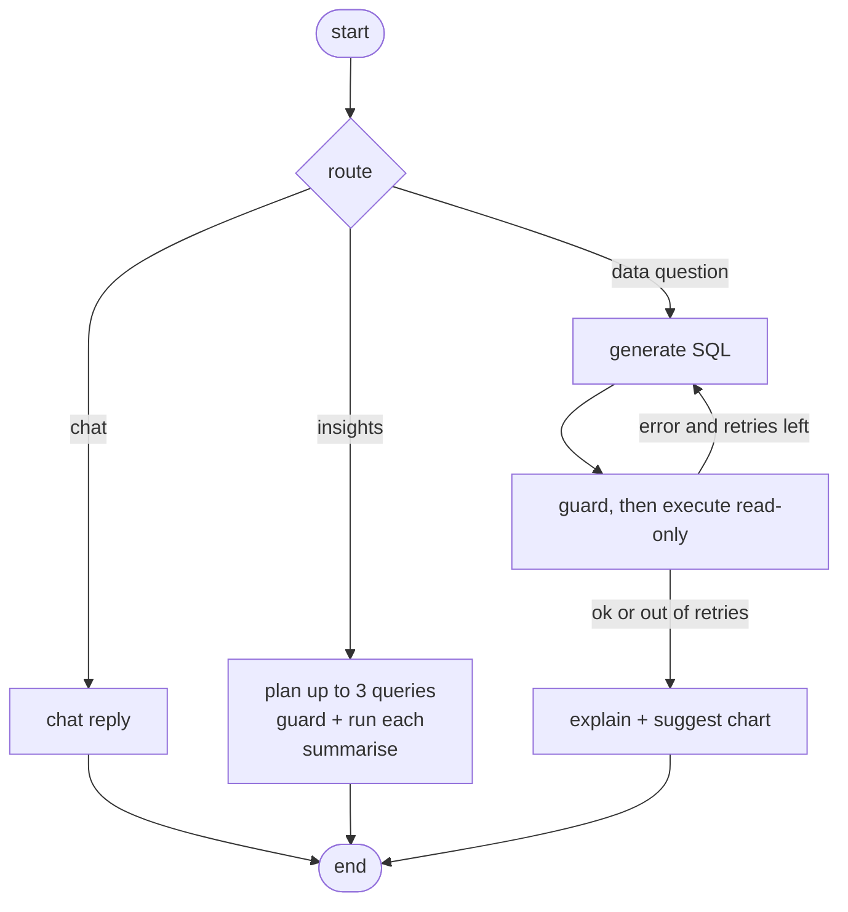

# Architecture

## Request lifecycle: `POST /query`

1. **Auth + rate limit**: JWT → user; sliding-window limiter (default 30/min/user).
2. **Dataset load**: the user's datasets and cached column profiles come from PostgreSQL. If the DuckDB file is missing
   (ephemeral disk), tables are rebuilt from the stored upload.
3. **Context building**: `schema_context` renders tables/columns (with value ranges and categorical values). Wide
   schemas are narrowed by TF-IDF retrieval plus join-partner expansion. Previous thumbs-up questions similar to this one are
   added as few-shot examples. For follow-ups, the parent question and SQL are added.
4. **Agent** (LangGraph):

   On a failure, the failing SQL and the error text (guard rejection or database error) are fed back into the prompt,
   which is the self-correction loop. An LLM outage is fatal and not retried.
5. **Logging**: one `query_logs` row per question (SQL, answer, status, attempts, latency, tokens, cost, provider/model,
   result preview, chart). This table is the source for metrics and for few-shot feedback.

## Components

| Module | Responsibility |
|---|---|
| `routers/*` | HTTP only: validation, auth, status codes |
| `services/query_service.py` | Orchestration: datasets → context → agent → log |
| `services/agent.py` | LangGraph graph and prompts |
| `services/sql_guard.py` | Security-critical validator (sqlglot) |
| `services/datastore.py` | DuckDB per-user store, ingestion, profiling, limited execution |
| `services/schema_context.py`, `retrieval.py` | Prompt context, TF-IDF retrieval |
| `services/charts.py` | Deterministic chart suggestion (no LLM call) |
| `llm/*` | Provider interface + Ollama, OpenAI-compatible, mock |
| `evals/` | Dataset generator, question set, runner/scorer |

## Data model (PostgreSQL)

- `users(id, email, password_hash, is_admin, created_at)`
- `datasets(id, user_id→users, name, table_name, filename, file_ext, row_count, profile JSON, file_blob, created_at)`, unique `(user_id, table_name)`
- `query_logs(id, user_id→users, parent_id→query_logs, question, route, sql, answer, status, error, attempts, row_count,
  result_preview JSON, chart JSON, latency_ms, llm_calls, prompt_tokens, completion_tokens, cost_usd, provider, model,
  feedback, created_at)`

User data itself lives in `data/user_<id>.duckdb`, one table per dataset.

## Key decisions and trade-offs

| Decision | Why | Cost / alternative |
|---|---|---|
| DuckDB for user data, PostgreSQL for app data | Columnar analytics on arbitrary uploads with zero server and hard read-only/no-file-access modes; Postgres for relational app state | Two stores to reason about; per-user lock |
| Per-user DB files | Strongest tenant isolation: other tables are not on the connection | Not horizontally scalable without shared storage |
| Upload bytes stored in Postgres | Free hosts have ephemeral disks; tables can be rebuilt | Upload cap (10 MB); object storage (S3/R2) is the scale-up path |
| Heuristic router, no LLM call | Saves latency/cost; routes are few and keyword-separable | Misroutes unusual phrasing; swap in an LLM classifier if evals show it |
| TF-IDF retrieval | Deterministic, free, enough for dozens of tables | Weak on synonyms; embeddings behind the same interface |
| Deterministic charts | Free and predictable | Less clever than an LLM-designed chart |
| Provider interface | Same code runs on Ollama locally and a hosted API in production | Prompts must work across model sizes: measure with the evals |
| Errors as data in the agent loop | Guard and DB errors become model feedback | Each retry costs another LLM call (tracked in metrics) |

## Scaling path

Redis for rate limiting and a shared lock → object storage for uploads → Alembic migrations → background workers for
large uploads → pgvector/embeddings for retrieval → structured tracing (OpenTelemetry/Langfuse).
